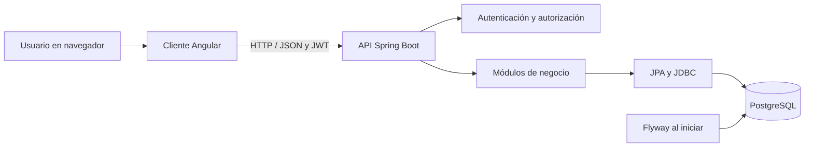

# Arquitectura de SGIP

Actualizado: **7 de noviembre de 2026**. Documento del estado implementado del proyecto local.

## 1. Enfoque arquitectónico

SGIP utiliza un **monolito modular** en el servidor y una aplicación de página única (SPA) en el cliente. Los módulos comparten despliegue y base de datos. No es una arquitectura de microservicios.

En desarrollo, Angular utiliza el puerto 4200 y Spring Boot el 8080; el puerto de PostgreSQL se configura mediante BD_PUERTO. Son procesos separados; el monolito se refiere al servidor de negocio.

## 2. Tecnologías y responsabilidades

| Componente | Tecnología y responsabilidad |
|---|---|
| Presentación | Angular 22.2, TypeScript 6, Angular Material, estilos SCSS y formularios reactivos. |
| API | Java con destino 21, Spring Boot 3.5.6; controladores REST y validación de solicitudes. |
| Seguridad | Spring Security, JWT HS256 y BCrypt. |
| Persistencia | Spring Data JPA para entidades y JDBC para consultas específicas/reportes. |
| Base | PostgreSQL relacional, con claves primarias, foráneas y restricciones. |
| Evolución del esquema | Migraciones versionadas con Flyway. |
| Contrato | OpenAPI mediante springdoc 2.8.13. |

Los controladores reciben las solicitudes, los servicios contienen reglas de negocio relevantes y los repositorios o consultas JDBC acceden a los datos. La separación no es uniforme en todos los módulos: varios controladores compactos concentran también lógica o persistencia. No se afirma una implementación estricta de arquitectura limpia o hexagonal.

La versión corregida incorpora ServicioErroresConocidos, políticas compartidas de estados y contraseñas, protección transaccional del último administrador y control optimista de concurrencia. Véase [Cierre de calidad](cierre-revision-calidad.md).

## 3. Organización modular

Raíz Java: `pe.gob.mtc.sgip`.

| Paquete | Responsabilidad |
|---|---|
| seguridad, identidad | Inicio de sesión, usuarios, roles, perfil y contraseñas. |
| incidencias | Registro, prioridad, asignación, atención, comentarios e historial. |
| problemas | Investigación de causas y relaciones con incidencias. |
| conocimiento | Errores conocidos y soluciones documentadas. |
| configuracion | Inventario y relaciones con incidencias/problemas. |
| categorias | Clasificación jerárquica y activación. |
| notificaciones | Avisos internos por usuario y estado de lectura. |
| auditoria | Registro de acciones y consultas administrativas. |
| reportes | Agregaciones del panel. |
| comun | Manejo de errores compartido. |

En Angular, `src/app/paginas/` contiene los módulos de interfaz y sus estilos; `src/app/nucleo/` reúne acceso a la API, autenticación, interceptores y traducción de etiquetas. Las páginas emplean componentes independientes y señales para el estado de la interfaz.

## 4. Modelo de datos

El modelo es **relacional**. Las entidades principales son usuarios, roles, categorías, incidencias, problemas, errores conocidos y elementos de configuración.

- `roles_usuario`: relación de muchos a muchos entre usuarios y roles.
- `incidencias_problema`: incidencias relacionadas con problemas.
- `elementos_incidencia` y `elementos_problema`: relaciones con el inventario.
- `historial_incidencias`, `comentarios_incidencia` y `comentarios_problema`: seguimiento operativo.
- `notificaciones` y `registro_auditoria`: avisos y trazabilidad.
- `categorias.padre_id`: relación autorreferencial de categoría superior; patrón de lista de adyacencia.

Los identificadores internos son independientes de los nombres de usuario. Las claves foráneas proporcionan integridad referencial. No se certifica cumplimiento integral de tercera forma normal sin una revisión formal de dependencias.

### Migraciones

| Versión | Función |
|---|---|
| V1__initial_schema.sql | Esquema inicial. |
| V2__problem_comments.sql | Comentarios de problemas. |
| V3__nombres_en_espanol.sql | Traducción de tablas, columnas y valores propios conservando datos. |
| V4__normalizar_nombres_usuario.sql | Elimina espacios exteriores en nombres de usuario; rechaza colisiones antes de actualizar. |
| V5__control_de_concurrencia.sql | Columnas de versión para detectar escrituras simultáneas. |

Las migraciones aplicadas no deben modificarse: Flyway verifica sus sumas de comprobación. Los cambios posteriores se realizan con nuevas migraciones.

## 5. Seguridad

El acceso utiliza JWT firmado y una API sin sesión HTTP de servidor. El cliente guarda el token y los datos de usuario en `sessionStorage`. El interceptor envía el token a las solicitudes protegidas y excluye el inicio de sesión para evitar adjuntar un token vencido.

La API vuelve a consultar el estado activo y los roles del usuario en cada solicitud autenticada. Los controles de interfaz facilitan la navegación; la autorización efectiva se aplica en el servidor.

| Operación | Roles principales |
|---|---|
| Registrar y consultar incidencias propias | Usuario autenticado. |
| Clasificar y asignar incidencias | Administrador, mesa de servicio y gestor de incidentes. |
| Cambiar estado de incidencias | Administrador, mesa de servicio, gestor de incidentes y técnico; el técnico sin otros roles actúa sobre sus asignaciones. |
| Crear y analizar problemas/errores conocidos | Administrador y gestor de problemas. |
| Crear y editar elementos de configuración | Administrador y mesa de servicio. |
| Crear categorías | Administrador y mesa de servicio. |
| Editar categorías existentes | Administrador. |
| Crear usuarios, asignar roles y consultar auditoría | Administrador. |
| Modificar perfil y contraseña propia | Usuario autenticado. |

Las contraseñas se almacenan con BCrypt. El restablecimiento administrativo no exige la contraseña anterior y registra la acción sin incluir el secreto en auditoría. La modificación propia exige la contraseña actual. No existe todavía cambio obligatorio al siguiente ingreso ni revocación de tokens por cambio de contraseña; las sesiones emitidas conservan su vencimiento.

Cada instalación debe configurar su propia conexión PostgreSQL y autenticación mediante contraseña. La configuración de despliegue institucional, TLS, respaldos, gestión de secretos y controles operativos requiere una etapa adicional de preparación.

## 6. Reglas operativas

### Incidencias

La prioridad se calcula sumando impacto y urgencia: Bajo=1, Medio=2, Alto=3 y Crítico=4. Suma 7–8: P1; 5–6: P2; 3–4: P3; 2: P4. Esta matriz es inicial y debe validarse con el MTC.

El cambio de estado admite las reglas documentadas: Nuevo a Cancelado; Asignado a En atención, Pendiente o Cancelado; En atención a Pendiente o Resuelto; Pendiente a En atención o Resuelto; Resuelto a Cerrado o En atención. La asignación inicial establece Asignado; las reasignaciones conservan el estado de los casos abiertos y se rechazan en Resuelto, Cerrado y Cancelado. Resolver exige una solución. No todas las transiciones del servidor se ofrecen como opción directa en la interfaz.

Los comentarios internos de incidencias se ocultan a los solicitantes. El historial registra cambios importantes. La reapertura de Resuelto a En atención limpia la fecha y la solución vigentes, conservando el registro de la solución anterior en el historial.

### Problemas y conocimiento

Los problemas conservan causa raíz, soluciones y vínculos con incidencias. Los errores conocidos contienen síntomas, causa conocida, soluciones y referencia a un problema. ServicioProblemas concentra las operaciones transaccionales y PoliticaEstadosProblema valida sus transiciones. Abierto pasa a En investigación; desde allí puede pasar a Error conocido o Resuelto. Error conocido permite volver a investigar o resolver. Resuelto permite reabrir la investigación o cerrar. Resolver y cerrar exigen una solución definitiva documentada. Estas reglas iniciales deben validarse con el procedimiento institucional. Véase [Correcciones de flujos](correcciones-flujos.md).

## 7. Consultas, filtros y límites

| Pantalla | Comportamiento |
|---|---|
| Panel | Fechas, estado, prioridad, categoría y técnico filtran incidencias; otros conteos son generales. |
| Incidencias | Paginación de 10 y filtro de estado en API; cambiar estado del filtro vuelve a la primera página. |
| Problemas, usuarios, categorías e inventario | Búsqueda local sobre los registros cargados en sus listados. |
| Errores conocidos | Búsqueda por palabra clave y categoría en API. |
| Notificaciones | Últimos 100 avisos de la cuenta; filtros locales de lectura. |
| Auditoría | Hasta 50 registros por página en la interfaz; API limita tamaño entre 1 y 100. |
| Vinculación de incidencias | Selectores cargan hasta 100 incidencias. |

Auditoría recibe `desde` y `hasta` como fechas. El servidor convierte el inicio a medianoche en `America/Lima`, filtra con límite inferior inclusivo y límite superior exclusivo al comienzo del día posterior a `hasta`. Rechaza rangos invertidos. La fecha mostrada en auditoría utiliza UTC−05:00.

Los desplegables de acción, entidad y usuario de auditoría se generan a partir de la página actual y filtran solo esa página. Se reinician al cargar resultados; no son filtros globales de servidor. Se conserva la última página correcta si falla una consulta. El orden es fecha descendente e ID descendente.

## 8. API principal

| Recurso | Finalidad |
|---|---|
| /api/autenticacion/ingresar | Inicio de sesión. |
| /api/usuarios y /api/roles | Administración de cuentas y roles. |
| /api/usuarios/mi-perfil | Perfil propio. |
| /api/usuarios/mi-perfil/contrasena | Cambio de contraseña propia. |
| /api/usuarios/{id}/contrasena | Restablecimiento administrativo. |
| /api/incidencias | Casos, asignación, clasificación, estado, comentarios e historial. |
| /api/problemas | Problemas, análisis y relaciones. |
| /api/errores-conocidos | Base de conocimiento. |
| /api/configuracion | Elementos y relaciones. |
| /api/categorias | Categorías y jerarquía. |
| /api/notificaciones | Avisos y lectura. |
| /api/reportes/panel | Indicadores. |
| /api/auditoria | Consulta administrativa paginada y por fechas. |

Se utilizan JSON y códigos HTTP de éxito, validación, autenticación y autorización. Incidencias y otros módulos con entidades exponen DTO; algunas consultas JDBC, como auditoría, devuelven mapas con campos del esquema (`creado_en`, `actor_id`). No todos los recursos comparten la misma envoltura de paginación. El contrato detallado puede consultarse en `/v3/api-docs`.

## 9. Configuración y operación

Las variables de `.env` incluyen conexión (`BD_HOST`, `BD_PUERTO`, `BD_NOMBRE`, `BD_USUARIO`, `BD_CONTRASENA`), JWT (`JWT_SECRETO`, `JWT_DURACION`), administrador inicial (`ADMIN_USUARIO`, `ADMIN_CONTRASENA`), origen CORS y puerto del servidor. La carga del archivo se realiza en la terminal antes de iniciar Maven; no debe suponerse lectura automática por Spring.

`.env` y `.tools/` están excluidos de Git. El repositorio conserva código y migraciones, no una copia de los datos locales. El administrador inicial se crea según la inicialización del sistema; cambiar su variable de contraseña no restablece una cuenta existente.

## 10. Verificación y deuda pendiente

Existen pruebas de prioridad e integración con PostgreSQL y pruebas de acceso del cliente. La integración se habilita con `SGIP_PRUEBAS_INTEGRACION=true` y una base independiente. Las mejoras recientes de interfaz se comprobaron principalmente mediante compilación; no representan una prueba exhaustiva de interacción, accesibilidad ni permisos en cada pantalla.

El último build registrado de Angular produjo aproximadamente 525,78 kB iniciales y una advertencia respecto del presupuesto de 500 kB. Conviene revisar la carga de módulos y dependencias sin ocultar la advertencia aumentando el límite arbitrariamente.

Pendientes: SLA oficiales, adjuntos, estructura institucional, grupos de soporte, recuperación de contraseña por correo, revocación de sesiones por cambio de contraseña, mayor cobertura de pruebas y revisión integral de transiciones y permisos. La consulta y paginación de volúmenes grandes también requieren evolución.

## 11. Documentos relacionados

- [README](../README.md)
- [Manual de usuario](MANUAL_DE_USUARIO_SGIP.md)
- [Guía de ejecución](INSTRUCCIONES_PARA_EJECUTAR.md)

`architecture.md` y `arquitectura.md` contienen la misma versión para conservar compatibilidad con los nombres solicitados y existentes. Su contenido debe mantenerse sincronizado.
