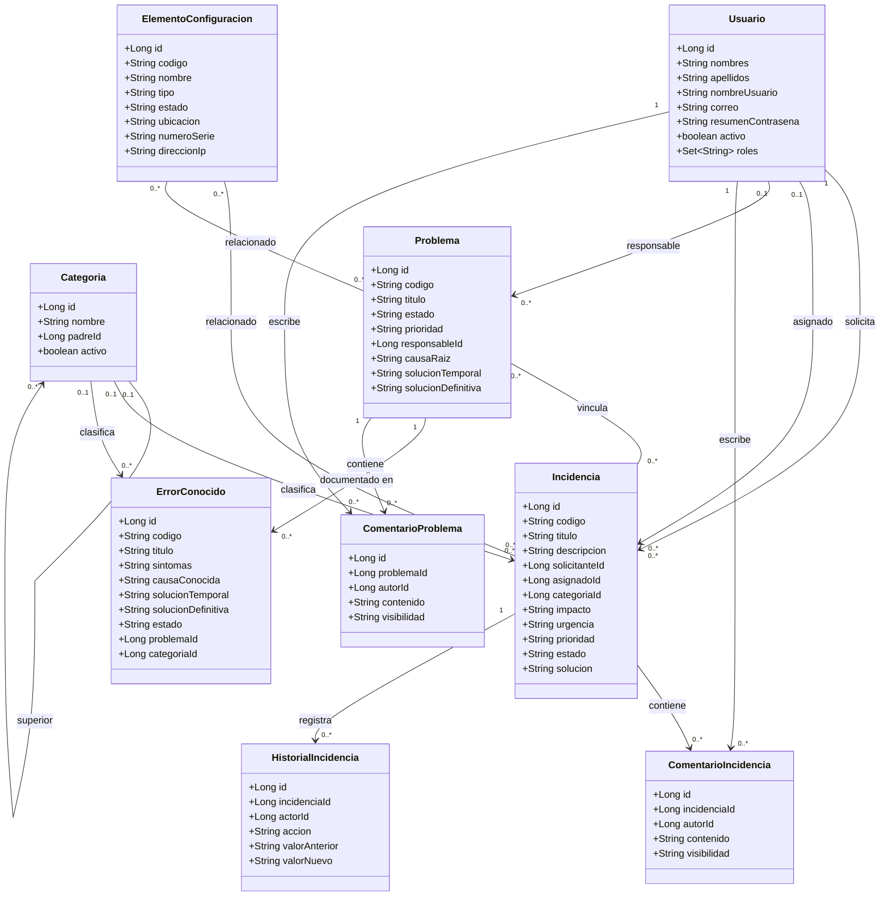

# Diagrama de clases de dominio

Versión 0.1 · 7 de noviembre de 2026. Basado en las entidades y controladores actuales. Se muestran atributos principales; se omiten campos de fecha para facilitar la lectura.

Las asociaciones representan relaciones del dominio y la persistencia. En Java muchas se implementan mediante identificadores Long y consultas JDBC, no mediante referencias de objetos JPA. Los roles de Usuario son un conjunto de cadenas; no se inventa una clase Rol en la implementación. ElementoConfiguracion es el nombre descriptivo utilizado en este modelo; comprobar su correspondencia con el nombre de la entidad antes de generar código.

Fuentes: clases Usuario, Incidencia, ComentarioIncidencia, HistorialIncidencia, ComentarioProblema y entidades declaradas en los controladores de categorías, problemas, conocimiento y configuración. Este diagrama no sustituye al diagrama físico de la base de datos.
