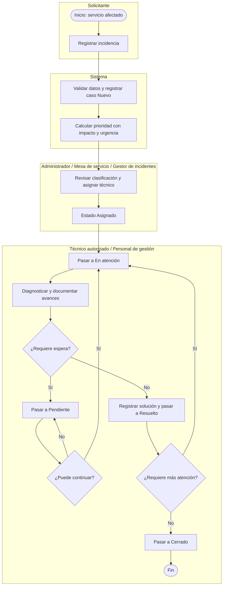
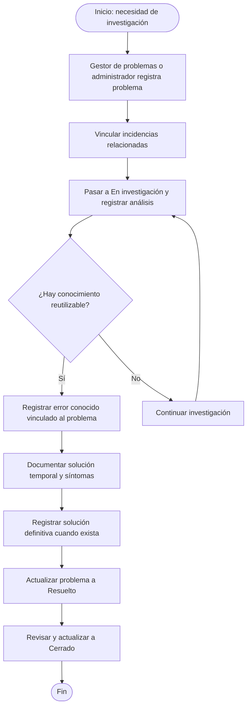

# Procesos de negocio — BPM

Versión 0.1 · 7 de noviembre de 2026. Modelos de flujo documentados con Mermaid. **No son archivos BPMN 2.0 ni procesos ejecutables.** Las agrupaciones indican responsabilidades. Para una entrega que exija BPMN formal, deben convertirse a eventos, tareas, compuertas y carriles y validarse en un editor BPMN.

## Atención de incidencias

Flujo principal implementable con la interfaz actual. Omite variantes de cancelación para no confundirlas con acciones visibles: el servidor admite determinadas cancelaciones, pero no todas están expuestas en el formulario. El cierre lo realiza personal autorizado; no existe una aprobación obligatoria del solicitante.

El servidor exige una solución para resolver y valida transiciones. La asignación inicial cambia el estado a Asignado. Reasignar conserva el estado abierto y se rechaza en Resuelto, Cerrado y Cancelado. Los comentarios, historial y notificaciones acompañan la atención según las operaciones implementadas.

## Investigación de problemas

Secuencia de trabajo propuesta utilizando funciones existentes. El servidor valida las transiciones descritas en [Correcciones de flujos](../correcciones-flujos.md) y exige una solución definitiva para resolver o cerrar. No crea problemas automáticamente por recurrencia; los pasos de análisis del diagrama son una guía operativa. Registrar un error conocido es una acción separada; cambiar el estado del problema no genera la ficha automáticamente.

## Aspectos pendientes de validación institucional

- Criterios para reconocer recurrencia y abrir problemas.
- Responsables de aprobación y cierre.
- Tiempos objetivo, escalamiento y SLA.
- Reglas para publicar o retirar soluciones conocidas.

Estos puntos no deben presentarse como automatizaciones implementadas.
